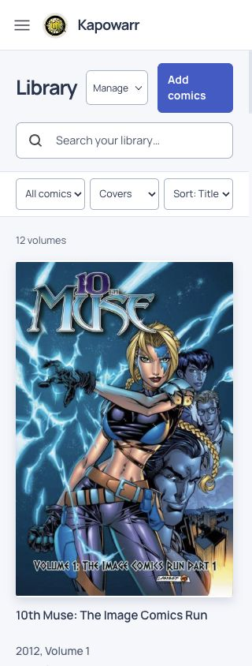
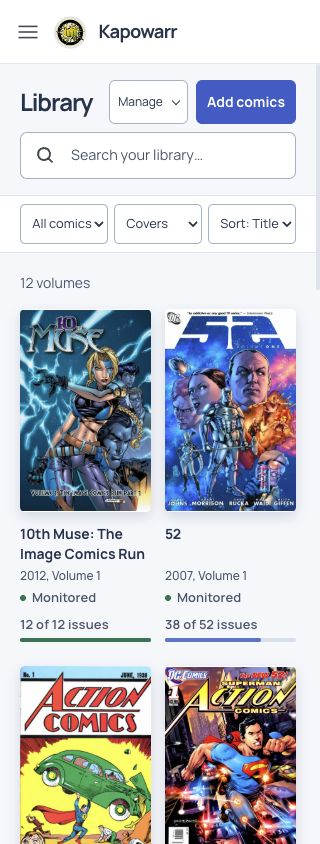
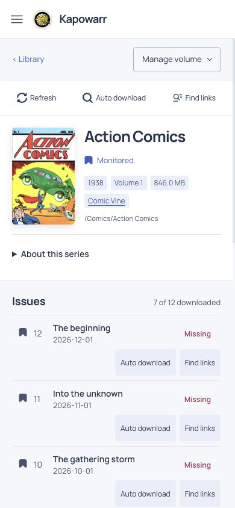
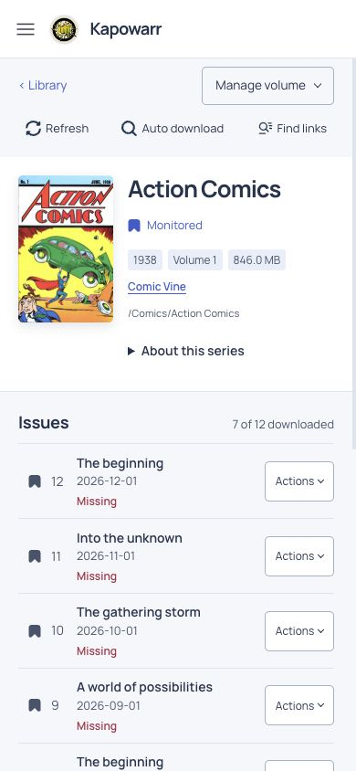

# UI polish comparison

These frozen sample-library screenshots compare the start and end of the final five-round polish pass. The baseline already includes earlier changes in this pull request; it is not a screenshot of main. Both variants use the same fixture data, light theme and viewport size.

| View | Before | After |
|---|---|---|
| Library, 320×844 |  |  |
| Issues, 390×844 |  |  |

Three fresh independent reviewers inspected eleven matching before/after views plus the opened phone Actions menu. Overall before→after scores were 8.2→9.3, 8.0→9.2 and 8.0→9.2. Each ranked the final version first. The requested three 10/10 scores were not achieved within five candidate rounds. Remaining feedback concerned tight tablet status/action spacing, repeated desktop action backgrounds and subdued secondary dark metadata.

Validation: 25 frontend tests, 137 Python tests and 22 fixture-browser checks passed. Browser checks covered issue-action layout from 320–1920px, dialog focus in both resize directions, Tab containment, inert background, search/clear/filter/list behavior, navigation Escape and the API-key label. Fixture checks do not verify live provider searches or downloads. Screen-reader speech and the rebuilt installed app were not tested.
